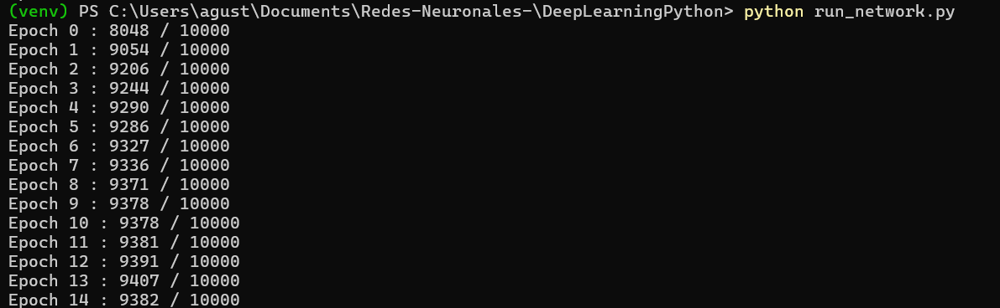

# Redes Neuronales

Implementaciones en Python 3 de las redes neuronales del libro
[Neural Networks and Deep Learning](http://neuralnetworksanddeeplearning.com)
de Michael Nielsen, entrenadas sobre el dataset MNIST (dígitos escritos a mano).

El código parte del repositorio de Michał Dobrzański, que adaptó los scripts
originales a Python 3.

## Estructura

```
.
├── run_network.py        # Mi script: entrena network.py [784, 30, 10] durante 15 épocas
├── ejemplos_libro.py     # Ejemplos de configuraciones por capítulo del libro (antes test.py)
├── src/
│   ├── mnist_loader.py   # Carga el dataset MNIST
│   ├── network.py        # Cap. 1-2: red básica con SGD y backpropagation
│   ├── network2.py       # Cap. 3: entropía cruzada, regularización, early stopping
│   ├── network3.py       # Cap. 6: redes convolucionales (requiere Theano)
│   ├── mnist_average_darkness.py  # Clasificador ingenuo de referencia
│   ├── mnist_svm.py      # Clasificador SVM de referencia (requiere scikit-learn)
│   └── expand_mnist.py   # Genera un MNIST ampliado desplazando imágenes
├── data/
│   └── mnist.pkl.gz      # Dataset MNIST
├── models/
│   └── MyNetwork.json    # Red guardada con network2.save() (se carga con network2.load())
└── results/
    └── run_network_15_epocas.png  # Captura del entrenamiento con run_network.py
```

## Uso

```bash
python -m venv venv
source venv/bin/activate        # En Windows: venv\Scripts\activate
pip install -r requirements.txt

python run_network.py
```

Los scripts se pueden ejecutar desde cualquier directorio: las rutas al dataset
se calculan de forma relativa a los archivos.

Las referencias de `src/` se ejecutan directamente, por ejemplo:

```bash
python src/mnist_average_darkness.py
```

## Resultados

`run_network.py` entrena una red `[784, 30, 10]` con 15 épocas, mini-batches
de 7 y tasa de aprendizaje 0.8. Alcanza alrededor de un **94 %** de aciertos
sobre los 10 000 ejemplos de prueba (máximo de 9407/10000 en la época 13).



## Notas

- `ejemplos_libro.py` ejecuta por defecto el ejemplo de `network3.py`, que
  necesita Theano. Theano ya no se mantiene y es difícil de instalar en
  versiones recientes de Python; para probar los demás ejemplos, descomenta el
  bloque que quieras y comenta la parte de `network3`.

## Licencia

Distribuido bajo la licencia MIT. Ver [LICENSE.md](LICENSE.md).
